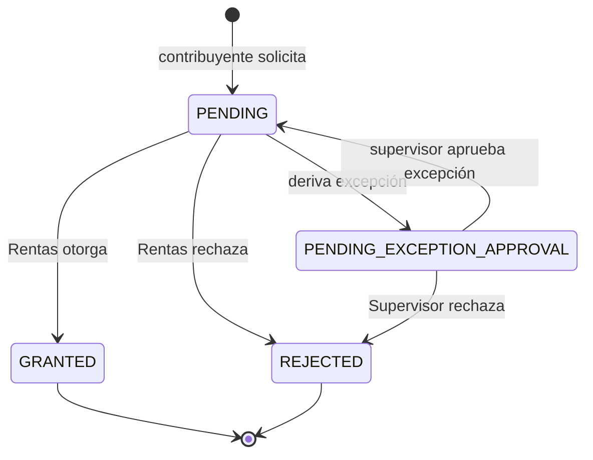
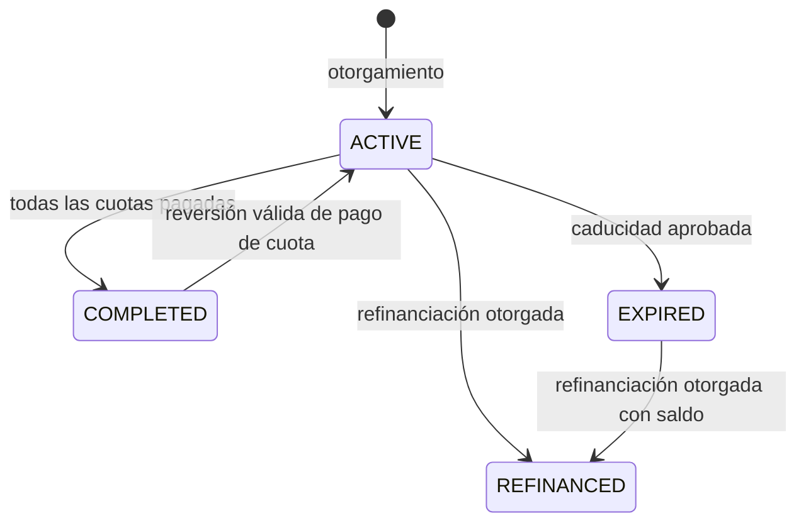

# Estados y transiciones verificadas de M5

Este documento describe las reglas encontradas en los workflows existentes; no
introduce reglas nuevas. Los enums incluyen valores que no necesariamente son
alcanzables por los casos de uso actuales.

## Solicitud de plan de pago

`GRANTED` crea el plan y sus cuotas. Una solicitud ya resuelta no se vuelve a
otorgar o rechazar. Implementación: `PlanWorkflowService.request`,
`submitException`, `approveException`, `rejectException` y `grant`.
La aprobación de una excepción marca `exceptionApproved` y devuelve la solicitud a
`PENDING`; el otorgamiento ocurre después por la transición `PENDING` → `GRANTED`.

## Plan y cuotas

Cuotas: `PENDING` puede pasar a `PARTIALLY_PAID` o `PAID`; una cuota puede
quedar `OVERDUE` al procesar vencimientos; las cuotas no pagadas de un plan
caducado/refinanciado se marcan `CANCELLED`. Las transiciones económicas de
cuotas actualizan también plan, deuda, asignaciones y ledger en una transacción.

## Otras solicitudes con resolución

| Flujo | Pendiente | Resolución válida | Efecto principal | Evidencia |
|---|---|---|---|---|
| Reversión | `PENDING_APPROVAL` | `APPROVED` / `REJECTED` | La aprobación habilita ejecución posterior; no revierte por sí sola | `DomainServices.java` (`ReversalService`) |
| Exención | `PENDING`, `UNDER_REVIEW`, `DOCUMENTATION_REQUIRED`, `PENDING_RESOLUTION` | `APPROVED` / `REJECTED` | Sólo la aprobación crea la exención; revisión y solicitud no cambian deuda | `DomainServices.java` (`ExemptionService`) |
| Ajuste | `PENDING_APPROVAL` | `APPROVED` / `REJECTED` | Sólo aprobación aplica el ajuste económico | `AdjustmentRunServices.java` |
| Caducidad | `PENDING_APPROVAL` | `APPROVED` / `REJECTED` | La aprobación cambia plan/cuotas y libera deudas del plan | `PlanWorkflowService.java` |
| Refinanciación | `PENDING` / `PENDING_EXCEPTION_APPROVAL` | `GRANTED` / `REJECTED` | Otorgamiento crea el nuevo plan dentro de la transacción | `PlanWorkflowService.java` |

## Por qué no se implementa GoF State

Las reglas se expresan actualmente con enums, guards explícitos y métodos
transaccionales por caso de uso. El diagrama ayuda a revisar los límites, pero
no se encontró una duplicación de comportamiento entre estados que justifique
objetos de estado. Refactorizar estos workflows acoplados a pagos, asignaciones,
deudas y Outbox ampliaría el riesgo sin cambiar el comportamiento. Si aparece
una nueva familia de reglas por estado, reevaluar con pruebas de transición
antes de introducir State.
