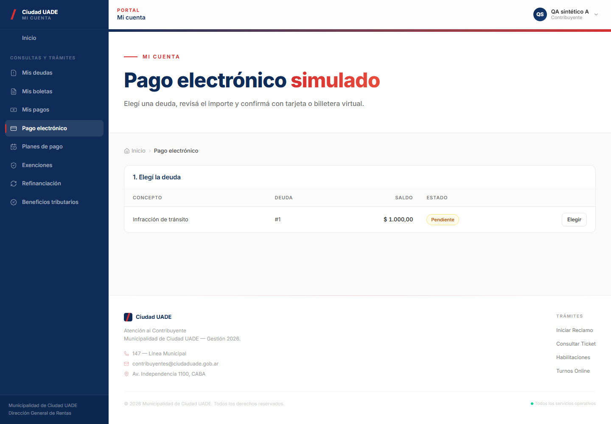
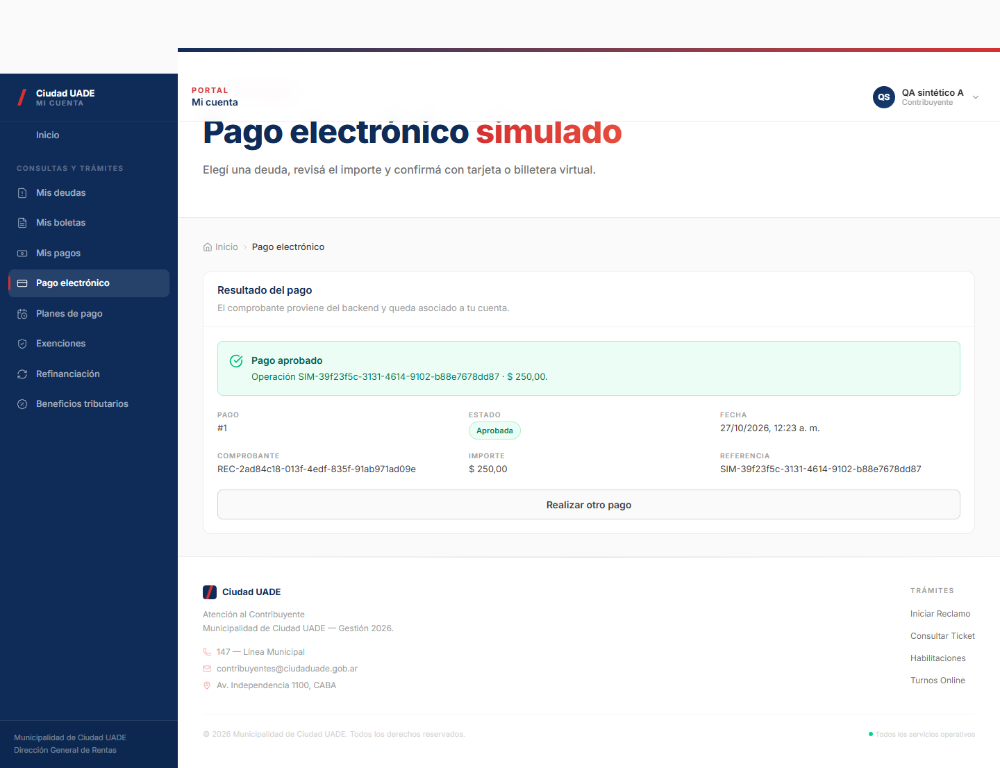
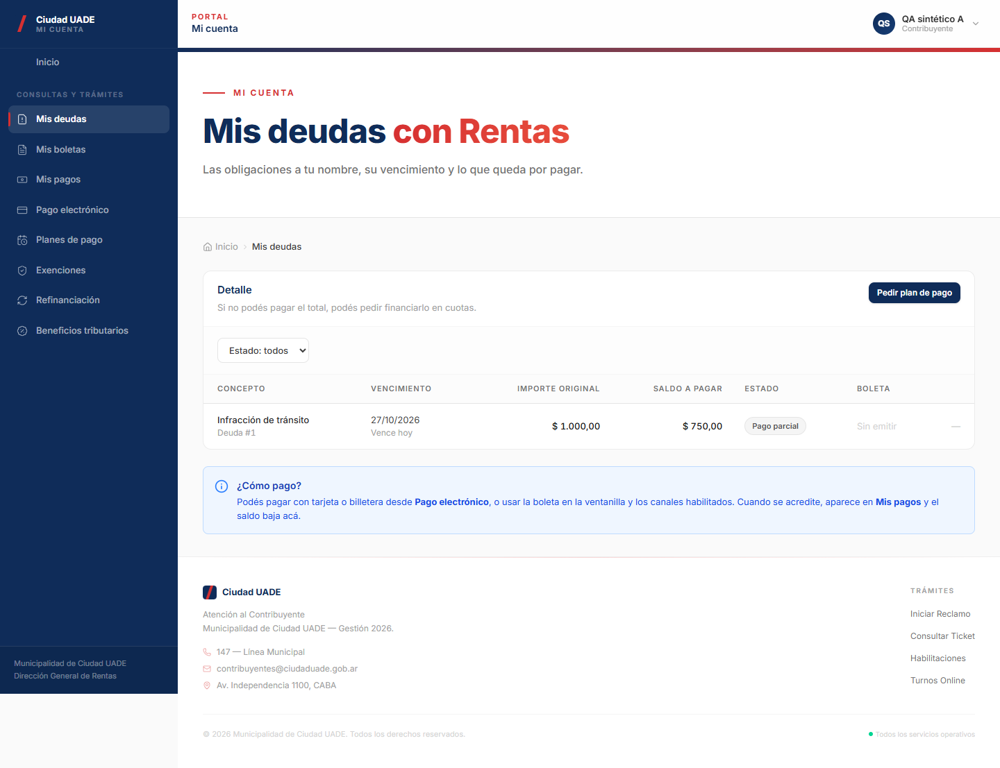
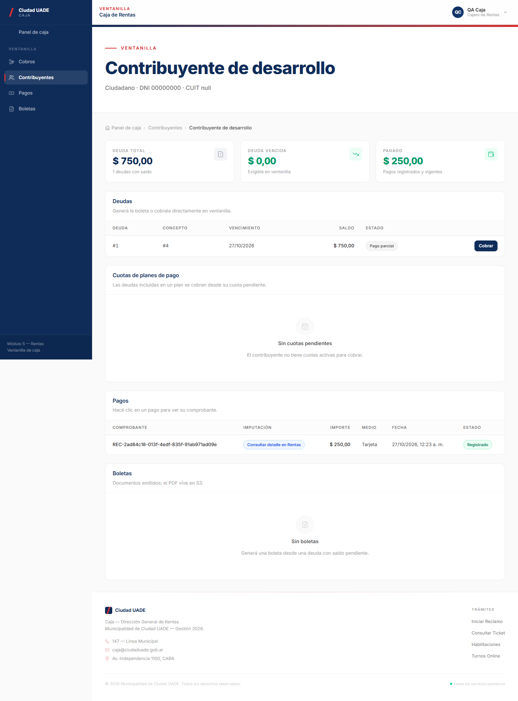
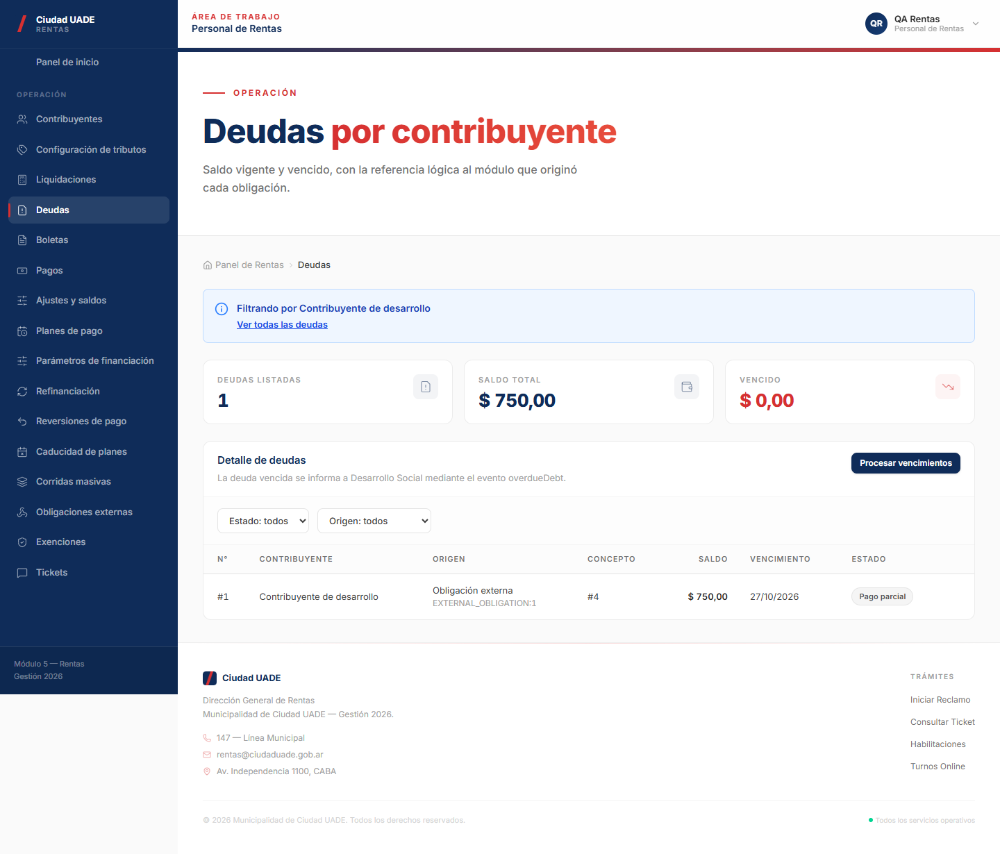

# Evidencia E2E local M5 — RabbitMQ/Core

Ejecución aprobada sobre el commit de código `d80cd1967d9398bd725d3cba06ea8f2994613a4c`.

## Alcance verificado

- 27/27 aserciones Playwright aprobadas; sin errores de página, errores inesperados de consola ni fallos de recursos.
- PostgreSQL `17.11-alpine` y RabbitMQ `4.3-management`, en contenedores efímeros aislados.
- Flujos visuales de Contribuyente, Caja y Rentas; pago con reintento idempotente y lecturas autorizadas de dos contribuyentes sintéticos.
- El Outbox publicó un evento y el broker local lo confirmó (`BROKER_CONFIRMED`).

## Evidencia

- [Aserciones detalladas](assertions.json)
- [Manifiesto de la ejecución](run-manifest.json), con identificadores sintéticos y puertos efímeros.

### Capturas

## Resultados de regresión reportados

- Backend: 446/446 tests aprobados.
- Frontend: 319/319 tests aprobados.
- JaCoCo líneas: 90,74%; gate aprobado.
- PostgreSQL 17.11 y Flyway V28: aprobados.
- RabbitMQ local 4.3: confirmado.
- `npm audit`: 0 vulnerabilidades reportadas.

Estos resultados corresponden a la ejecución registrada para el commit de código indicado arriba. Esta carpeta sólo agrega evidencia documental y capturas.

## Límites

`BROKER_CONFIRMED` sólo prueba que el broker local aceptó la publicación. No se verificaron `CORE_DELIVERED`, `CONSUMER_ACK`, Core/M9 real, credenciales productivas, ni interoperabilidad externa. La cola `q.rentas` no se declara activamente sobre un Core externo. Los identificadores y contribuyentes usados son sintéticos.

El arnés ejecutable se conserva en una copia local de evidencia; no se versiona aquí porque depende del entorno de desarrollo y de artefactos locales. No se publican rutas locales, credenciales ni tokens.
